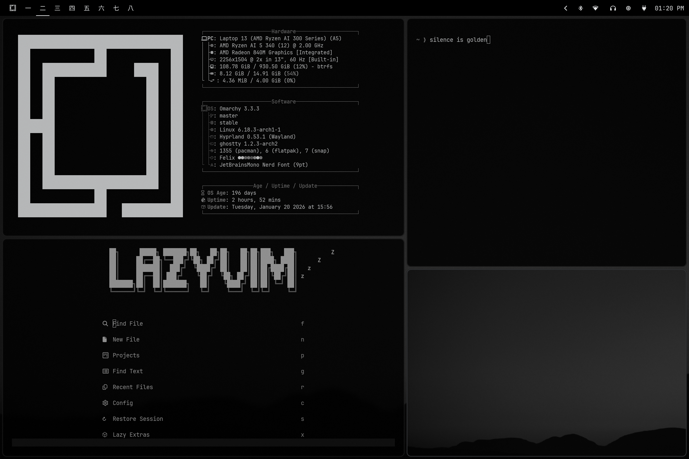

# Felix — Omarchy Quattro Theme

A dead-simple theme for the digital minimalist: quiet black and white, one warm orange accent, edge-to-edge windows, and a large set of subtle backgrounds. No clown-color text. No wasted space. No nonsense.

Einstein and Jobs wore the same damn thing every day. Now you can too.



## Install

```bash
omarchy theme install https://github.com/TyRichards/omarchy-felix-theme.git
```

## Quattro port

The old Waybar, Mako, Walker, SwayOSD, and Hyprlock configs were retired. Their equivalent styling now lives in [`shell.toml`](shell.toml), where each Quickshell section is clearly labeled with its Omarchy 3 source.

[`colors.toml`](colors.toml) uses Quattro's semantic palette and generates the standard terminal, editor, Gum, Pi, Helix, Obsidian, VS Code, and app themes. The active Hyprland border remains neutral gray instead of inheriting Felix's orange UI accent.

### Hyprland

[`hyprland.lua`](hyprland.lua) preserves the zero-gap layout, 1px borders, rounded corners, blur profile, group bar, and full-opacity behavior of the original config.

Omarchy intentionally ignores executable Lua from a Git-cloned third-party theme. Normal installs still get the correct safe neutral borders from `hyprland_active_border` and `hyprland_inactive_border` in `colors.toml`; the complete compositor override is available when this repository is used as a trusted local theme.

## Optional tmux styling

```tmux
source-file -q ~/.local/state/omarchy/current/theme/tmux.conf
```

## Omarchy 3 archive

The complete pre-migration version is archived at [TyRichards/omarchy3-felix-theme](https://github.com/TyRichards/omarchy3-felix-theme).
